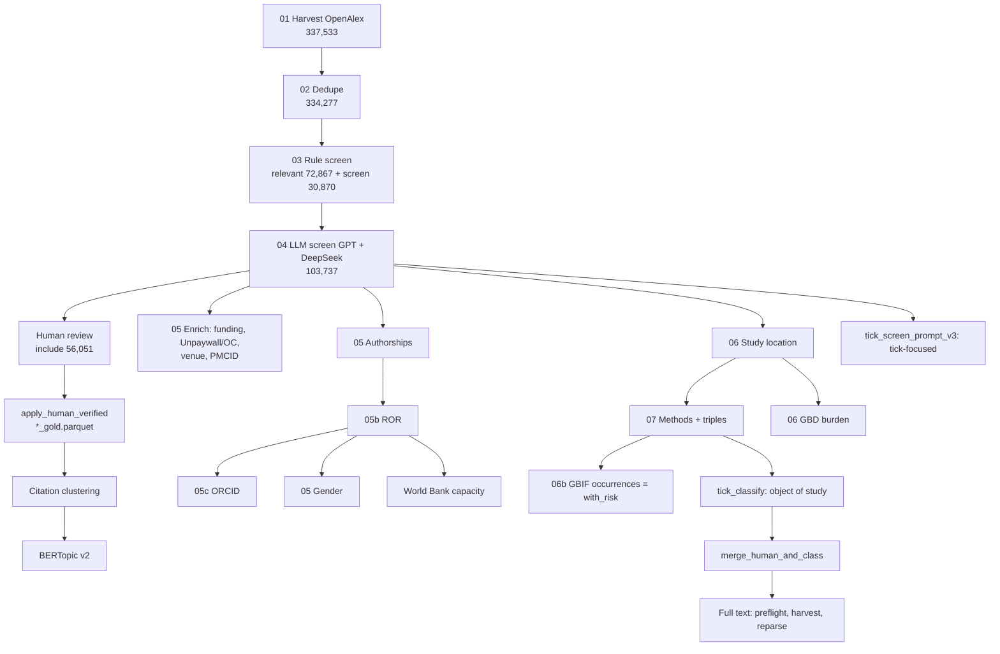

# Reproducibility guide — how the GTRA data was built

Reconstructed on 2026-11-25 from 42 Colab notebooks, the `sosci-pipeline` package, the Drive folder `ticks/` and the link list "save link from scholcommlab computer". Counts are copied from the notebooks' saved outputs. Items marked **FLAG** could not be found or need a decision.

All notebooks ran in Google Colab with the laptop's Drive mounted at `/content/drive/Othercomputers/My laptop/D:/COGNOS X bon/ticks/` (here written `ticks/`). API keys came from Colab secrets: `OPENALEX_API_KEY`, `OPENAI_API_KEY`, `DEEPSEEK_API_KEY`, `GEMINI_API_KEY`, `ANTHROPIC_API_KEY`.

## Two tracks, one shared start

| Track | Question | Harvest | Working folder | Engine |
| --- | --- | --- | --- | --- |
| **A — climate review** | Does the study evaluate the impact of climate on ticks? | Search Strategy S2: ticks AND climate, 7 databases, run 2026-06-02 | `TICKs_and_climate_change/preprocessing_data_v2/` | `sosci-pipeline` v2.2–2.3 runners |
| **B — broad atlas (this repo)** | Is the record genuinely about ticks or tick-borne disease? | OpenAlex only, tick terms only, 2000–2026 | `ticks/preprocessing_data/` | Numbered Colab notebooks |

Track B is the base for GTRA. Track A results (`topic_taxonomy.csv`, the SSA odds ratios, climate by year) came from the `sosci-pipeline` runners.

## Flow (track B)

## Step by step

Notebook links open in Colab (owner access).

### Stage 1 — Corpus

| # | Step | Notebook | Input → output | Key settings | Counts | Status |
| --- | --- | --- | --- | --- | --- | --- |
| 1 | Harvest | [01_OpenAlexHarvester_Ticks](https://colab.research.google.com/drive/1dOxnXtMShRe8yZa_FMa3SUOqsyvQOgYq) | OpenAlex API → `data_raw/combined.parquet`, `oa_ticks.csv` | `search=` 21 tick genera + Ixodidae/Argasidae/Ixodida/Nuttalliellidae/acari + "tick", "ticks", "tick-borne", "tick borne"; years 2000–2026; types article, review, letter, preprint; `is_paratext=false` | 337,533 | Done. **FLAG** raw `combined.parquet` not found in Drive |
| 2 | Deduplicate | [02_dedupe](https://colab.research.google.com/drive/1vINRtqDOGTQo_HtW4dfIJ1ofXUwOZ50N) (+ `02_dedupe_synthesis`) | `combined.parquet` → `master_canonical.parquet` (577 MB), `master_dedupe_audit`, 3 QC sheets | Union-find: OpenAlex ID → DOI → title+author+year → fuzzy title ≥ 90, year ± 2 (`src/sosci_pipeline/dedupe.py`) | 334,277 | Done |
| 3 | Rule-based tick screen | [03_tick_screen](https://colab.research.google.com/drive/1JI7vSS782yzBzWOromJqYzPN6-DYRuHa) | `master_canonical` → `canonical_screened.parquet` | Tiers from genus/family names, tick MeSH, tick vocabulary, acari terms, homonym fields | relevant 72,867 · screen 30,870 · irrelevant 230,540 | Done |
| 3b | Diagnostics | [03_screening_diagnostics](https://colab.research.google.com/drive/1WhIq4WUhSNC5rXMsxkEmrcLlU2y6Z3SO) | `master_canonical` | — | genus/MeSH-positive 47,297 · generic "tick" only 39,624 · **matched via full text only 247,356 (74%)** | Done |
| 4 | LLM tick-relevance screen | [04_llm_screen](https://colab.research.google.com/drive/14ROh4R84uxMud-pK4AwkFl_lE_CzumuU) | `canonical_screened` (relevant + screen) → `llm_screen/screened_llm.parquet` (585 MB) | gpt-4o-mini, deepseek-v4-flash, gemini-2.5-flash; labels TICK_RELEVANT / NOT_TICK / UNCERTAIN; fields title, abstract, keywords, MeSH, concepts, journal, OpenAlex topic | 103,737 screened | Done. Gemini failed (below) |
| 4b | Screen validation | [04_screen_validation](https://colab.research.google.com/drive/19WQ8xHCpPqh9HbmxDBxcJdvEhr9iX8VA) | `screened_llm` → `audit.csv`, `validation_sample.csv` | Fleiss' kappa, rules vs LLM 2×2 | GPT vs DeepSeek κ = 0.888 (n = 101,931) · Gemini 0% valid (103,643 API errors) | Done |
| 5 | Human review | (Excel) | `llm_screen_human_validation.xlsx` (171 MB), column `final_include` | **FLAG** no written protocol: who reviewed, which rows were read, rules used | include 56,051 · exclude 47,686 | Done, undocumented |
| 6 | Apply human labels | [apply_human_verified](https://colab.research.google.com/drive/1nxax46iVLKx9cVNDv-pY6xkaADdkcGLP) | review xlsx + every derived parquet → `gold_included_ids.parquet`, all `*_gold.parquet`, `screener_validation_by_region.csv` | Subsets by `oa_id`; nothing re-harvested | 56,051 gold | Done |

### Stage 2 — Enrichment (on the 103,737 screened records, then subset to gold)

| # | Step | Notebook | Input → output | Method | Counts | Status |
| --- | --- | --- | --- | --- | --- | --- |
| 7 | Authorships re-harvest | [05_harvest_authorships](https://colab.research.google.com/drive/1T4NGzXAYsaJp6gQCE9TIrHnKs0UWUbx1) | `llm_screen_test.csv` → `clean.csv` | OpenAlex per-author records, `ftfy` | 103,737 | Done. **FLAG** output saved as `authorships_reharvested.csv` by hand (rename not in code) |
| 8 | ROR countries | [05b_ror_enrichment](https://colab.research.google.com/drive/1zlN-nlh0tFBq2vJkfZ1ld00ycSIBMd6u) | `authorships_reharvested.csv` → `ror_enrich.parquet` | ROR API back-fill of missing countries | 21,460 RORs | Done |
| 9 | ORCID careers | [05c_orcid_enrichment](https://colab.research.google.com/drive/1hz8EkFlw6CVuIl-H88nEwaN2mMhDk52O) | `ror_enrich` → `with_orcid.parquet`, `_orcid_features` | ORCID employment timelines | 122,954 ORCIDs | Done |
| 10 | Gender | [05_gender_enrichment](https://colab.research.google.com/drive/1du8_0zaR4ZOuNRKLgNVEDgAubz2i9JFN) | `ror_enrich` (+ `with_doi`) → `with_gender.parquet`, `gender_validation.csv` | gender-guesser, then gpt-4o-mini + deepseek-chat on name + country | 279,635 name–country pairs | Done. **FLAG** `with_doi.parquet` input not found |
| 11 | Funding | [05_funding_enrichment](https://colab.research.google.com/drive/1VF_x4EyMG5Z4OJcdHLf6eOXt3dT9EifB) | `screened_llm` → `funding_enrich.parquet` | OpenAlex grants + funders table (45,639 funders) | 102,587 fetched | Done |
| 12 | Open access + citations | [05_unpaywall_opencitations](https://colab.research.google.com/drive/1xIETQCkp3QX60C7Sa04akLXj7XMwHxzB) | `screened_llm` → `with_upw_oc.parquet` | Unpaywall, OpenCitations by DOI | 88,948 DOIs | Done |
| 13 | Venues | [05_venue_enrichment](https://colab.research.google.com/drive/1IgLntEbZqoMr3K5dhvH_IQu5UeO-MkSL) | `screened_llm` + `doaj_journalcsv_20260630_2320_utf8.csv` + `scimagojr_2025.csv` → `with_venue.parquet` | ISSN match, then journal-name fallback | matched 71,328 · unmatched 32,409 · quartile 66.1% | Done |
| 14 | PMCID back-fill | [pmcid_backfill](https://colab.research.google.com/drive/1nxqPH019betoc5cP_3HRCCzaTa3LJNu5) | `screened_llm` → `pmcid_backfill.parquet`, `with_pmcid.parquet` | NCBI ID Converter by DOI | 88,948 DOIs | Done |
| 15 | World Bank capacity | [ext_worldbank_capacity](https://colab.research.google.com/drive/1aKtVQtcH36QEl5V-fGIx7T09yqDYIDJr) | `ror_enrich` → `with_capacity.parquet`, `external_data/wb_*` | `wbgapi` country × year panel | 9,540 panel rows | Done |

### Stage 3 — Content extraction and benchmarks

| # | Step | Notebook | Input → output | Method | Counts | Status |
| --- | --- | --- | --- | --- | --- | --- |
| 16 | Study location | [06_extract_study_location](https://colab.research.google.com/drive/1a8awHAbiUw629PFQLmWGnPyJeljy9r2o) | corpus → `with_study_location.parquet`, `study_loc_validation.csv` | Gazetteer (pycountry) + MeSH | 116,377 of 334,277 with a country (34.8%) | Done |
| 17 | Methods + species × pathogen × host | [07_extract_methodology_and_triples](https://colab.research.google.com/drive/1VPySZJt7kBT-PAcSy5KxxwN7bDbacV0k) | `with_study_location` → `with_methods_triples.parquet`, `_validation.csv` (1,121 rows) | scispaCy `en_ner_bionlp13cg_md` + gpt-4o-mini / deepseek-chat consensus | 103,737 in scope | Done; validation sheet not yet scored |
| 18 | GBD burden | [06_ext_gbd_burden](https://colab.research.google.com/drive/1660u68SxqQTfN0VzthH4OmfA4ZKtD67t) | `gbd_daly_export.csv` + `with_study_location` → `with_burden.parquet`, `gbd_burden_country_year.parquet` | Manual export from [GBD Results](https://vizhub.healthdata.org/gbd-results/) | 204 countries | Done. **FLAG** raw GBD export and its query (causes, measures, years) not saved |
| 19 | GBIF tick occurrences | [06_ext_b_gbif_occurrences](https://colab.research.google.com/drive/17y8S-Fz7md7CyMBYWnbdZJBfyuCMDWHG) | `with_methods_triples` → `with_risk.parquet`, `GBIF/gbif_*` | GBIF API per taxon | 1,891 taxa | Done |
| 20 | Livestock | **FLAG** no notebook found | → `with_livestock.parquet` (read by `apply_human_verified`) | FAO? | — | **Missing** |
| 21 | Object of study (tickclass) | [tick_classify1–5](https://colab.research.google.com/drive/1foMtWFfYUpmhgNRDhuOwJm9SEzFUUJoX) + [tick_classify_all](https://colab.research.google.com/drive/1d5EY-u0aCjAMYdwEceNP9GY2c7L_8f7o) | `with_methods_triples` → `with_tickclass.parquet`, `tickclass_validation.csv` | Rules, then gpt-4o-mini + deepseek; 8 classes (tick_organism … disease_only, not_tick) | 103,738 · **OpenAI vs DeepSeek agreement 55.7%** (n = 4,100) | Done, low reliability |
| 22 | Tick-focused screen v3 | [tick_screen_prompt_v3](https://colab.research.google.com/drive/1Wf5GgvepUuSSLJjwNK2WbAViQgHNLMEu) | `screened_llm` → `tickclass2/screened_llm_v3.*` | "Did the study use physical ticks or tick material?" gpt-4o-mini + deepseek-v4-flash | 103,605 | Done |
| 23 | Merge human + class | [merge_human_and_class](https://colab.research.google.com/drive/1oYYQJE_RGgAuuC3kPo7oSbhnsKmxe7Dw) | review xlsx + tickclass → `merged_human_class(2).*`, `review_disagreements(2).xlsx` | — | human-included 55,553 vs matched 56,051 | Done. **FLAG** 498-record gap |

### Stage 4 — Structure and analysis

| # | Step | Notebook | Input → output | Method | Counts | Status |
| --- | --- | --- | --- | --- | --- | --- |
| 24 | Citation clusters | [citation_clustering](https://colab.research.google.com/drive/1gSm0ZNCZCcMeLmqMsvc--eOyebGuowPx) | `screened_llm_gold` → `citation_clusters_gold`, `with_clusters_gold`, `cluster_top_refs_gold` | Bibliographic coupling (≥ 2 shared refs) + Leiden | 39,666 papers with ≥ 3 refs | Done |
| 25 | Topics | [bertopic_multilingual_v2](https://colab.research.google.com/drive/1PLkDzsFkd5D7OJLhQVhHDWfGumcdgP6s) | `with_clusters_gold` → `with_topics_gold`, `bertopic_gold/*` | `paraphrase-multilingual-mpnet-base-v2` | 42,899 of 56,051 with abstracts | Done. **FLAG** 13,152 gold papers (23%) have no topic |
| 26 | Paper 3 equity | [paper3_equity_metrics](https://colab.research.google.com/drive/1yQi5BA7V8duDdow7z0Kb5H-QTKPVnhE3) | `with_study_location` → `paper3_equity_table.csv`, `paper3_trends.png` | Local first/last share, parachute rate, Gini, Mann–Kendall | 116,377 papers | Ran. **FLAG** used all 334,277 records, not the gold set |
| 27 | Paper 3 funder network | [paper3_funder_network](https://colab.research.google.com/drive/1Or6yubXEl0B6BS6WqkKSROOuDCy8Lwxj) | `funding_enrich` → `paper3_funding/funder_producer_*.csv` | networkx, statsmodels GEE | — | Ran. **FLAG** code also refers to `with_funding.parquet`, which does not exist |

### Stage 5 — Full text (subset)

| # | Step | Notebook | Input → output | Counts | Status |
| --- | --- | --- | --- | --- | --- |
| 28 | Pre-flight | [fulltext_preflight](https://colab.research.google.com/drive/1TXhHNTzugFRhgIttLEgLPRgAOJcOulVh) | `merged_human_class2` → `preflight_audit.csv`, `missing_ids.csv`, `fulltext_manifest.parquet` | 35,107 "included" studies | Done. **FLAG** how the 35,107 set was defined is not documented (probably tick-focused v3 ∩ human include) |
| 29 | Harvest | [fulltext_harvester_v5](https://colab.research.google.com/drive/1HeQrXqySY6U1vxER0i5-UqytPABq28Hu) | `merged_human_class2_pmcid.xlsx` → `fulltext3/raw`, `sections/*.json` | 13,197 full texts · 7,483 with target sections | Partial |
| 30 | Re-parse PDFs | [reparse_offline_v2](https://colab.research.google.com/drive/1wqoWPZGm4iL6iuvLBo7W0tU9YJfYwYzj) | 11,632 PDFs → manifest, `reparse_report.csv` | GROBID + PyMuPDF, `tick_sections.py` | Partial |
| 31 | Coverage check | [diagnose_coverage](https://colab.research.google.com/drive/1buEGD1GMDjFrKsJy7TBCnXT4RExfxZNy) | `merged_human_class2.xlsx` | 5,864 with no DOI, PMCID or PMID; 1,114 PMID-only never tried | Done |
| 32 | Full-text affiliations | [01c_fulltext_affiliations](https://colab.research.google.com/drive/1muh8PiMYJlzbIvJrVRFOGLtdqRO-neTI) | → `fulltext_affiliations.parquet` | 22,358 of 103,737 (21.6%) | Done |

### Side analyses (not in the main chain)

| Notebook | What | Status |
| --- | --- | --- |
| [biomining](https://colab.research.google.com/drive/1rRMcePEcWmmw2k5vInGvCYcBJ3idU-Ym), [biomining2_](https://colab.research.google.com/drive/1dHRTSfDLcRvhzW6fEAC0tIUpAybiBUlW) | MeSH, scispaCy, GLiNER entities + gpt-4.1-mini relations on `canonical_screened` | Partial: 486,930 entities from 44,217 docs; GLiNER stage stopped (ETA 16,355 min) |
| [02_pathogen_disease_NER_ticks](https://colab.research.google.com/drive/1afmWKxmaBA9QLpOmc3gBU_IdmlaFg8DA) | `en_ner_bc5cdr_md` + tick-disease gazetteer, ICD-11 mapping (phage-paper method) | Ran on track A (`master_tick_checked.parquet`) |
| [05_Methodology_Profile_v6b](https://colab.research.google.com/drive/1AsFdB5QPbCSpQbZUxIjVws7v1eEQb8re) | Ontology rules + optional LLM for methodology dimensions | Ran on 103,737 |
| [crossfill_opportunity](https://colab.research.google.com/drive/1GDozpnkS0fjc4gvKj3UrCZq9DFyeAa-q) | Which source fills which gap (track A, 114,013 records) | Done |

## Flags to resolve

| # | Severity | Flag | Suggested fix |
| --- | --- | --- | --- |
| 1 | Critical | The broad harvest used OpenAlex `search` (title, abstract **and full text**): 247,356 of 334,277 records (74%) have no tick term in their metadata | Re-harvest with `title_and_abstract.search`; keep the current set only as a recall check |
| 2 | Critical | Human review (56,051 includes) has no written protocol | Write it now: reviewers, what they read, rules, dates. Then run the blind validation in `validation/` |
| 3 | Critical | Paper 3 equity metrics ran on all 334,277 records, not on the gold set | Re-run on `with_study_location_gold.parquet` |
| 4 | Major | Three definitions of a "tick paper" co-exist: tick-relevant (56,051), tick-focused v3, full-text "included" (35,107) | Name them in the data dictionary; pick one denominator per paper |
| 5 | Major | Gemini returned 0% valid answers; "three-model" screening is two models | Report GPT + DeepSeek only |
| 6 | Major | tickclass models agree only 55.7% | Human-label `tickclass_validation.csv` before using classes |
| 7 | Major | Two topic models: the July run (47 topics → `topic_taxonomy.csv`, ~82,000 papers, track A runner) and the August gold run (42,899 papers) | Choose the gold run for GTRA; re-label it; topic-model papers without abstracts on titles |
| 8 | Major | Missing producers or files: `data_raw/combined.parquet`, `with_livestock.parquet` (+ its notebook), `with_doi.parquet`, `gbd_daly_export.csv` and its query, `oa_ticks.csv` | Check the laptop's `D:/COGNOS X bon/ticks/`; if lost, re-run step 1 and re-export GBD with its settings recorded |
| 9 | Minor | Manual renames (`clean.csv` → `authorships_reharvested.csv`), `with_funding` vs `funding_enrich` | Fix names in code |
| 10 | Minor | 498 records differ between human includes (55,553) and matched rows (56,051) | Check `final_include` parsing in `merge_human_and_class` |
| 11 | Minor | Many copies of notebooks (`Copy of`, `Copie de`, v1–v5) | Keep the ones linked here; archive the rest |

## Re-running in order

1. `01` harvest → `02` dedupe → `03` rule screen → `04` LLM screen → human review
2. In parallel, on the screened set: `05` authorships → `05b` ROR → `05c` ORCID / `05` gender / World Bank; and `05` funding, Unpaywall + OpenCitations, venue, PMCID
3. `06` study location → `07` methods + triples → `06b` GBIF, GBD, tickclass
4. `apply_human_verified` → citation clustering → BERTopic
5. Paper notebooks, then the full-text chain

Software: Python 3 in Colab; pandas, pyarrow, requests, rapidfuzz, ftfy, pycountry, wbgapi, scispaCy 0.5.4 (`en_ner_bionlp13cg_md`, `en_ner_bc5cdr_md`), BERTopic + sentence-transformers, python-igraph + leidenalg, statsmodels, pymannkendall, networkx, openai SDK (also used for DeepSeek), gender-guesser, GROBID client, PyMuPDF. Exact versions were not pinned: **FLAG**, add a `requirements.txt` from a fresh Colab run.
